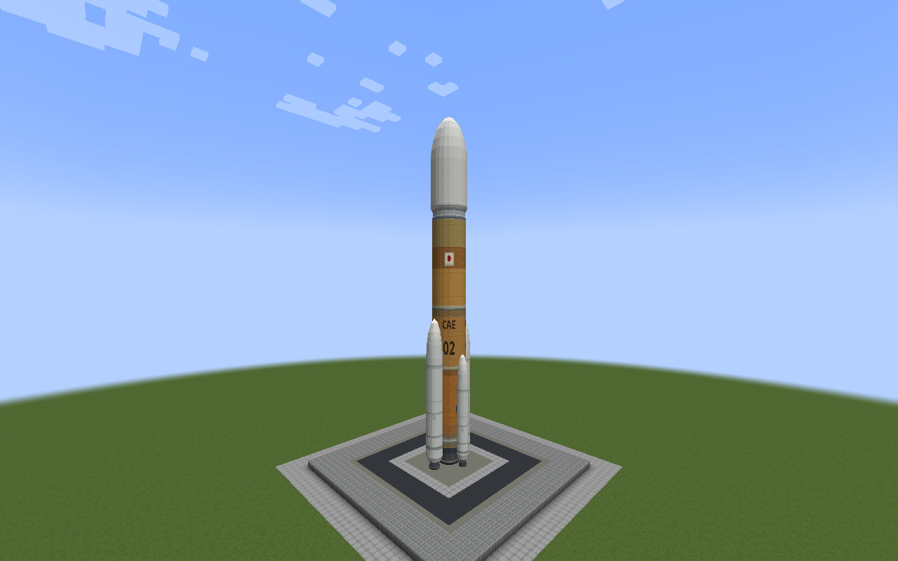

# Create: Aerospace Engineering

[English](README.md) | **日本語** · [変更履歴](CHANGELOG.md) · [詳しい仕様](docs/README.md)

発射台からロケットを打ち上げ、人工衛星を軌道に乗せ、地上管制コンソールで衛星を探して操作し、夜空を横切る様子を眺めるMODです。
[Create](https://modrinth.com/mod/create) が必要です。
[Create: Refinery 'n' Reactors](https://github.com/Chemi-Create-Team/chemicreate-sub) を入れると、その燃料も使えます。

すべて通常のワールドで起こります。宇宙へ行くことはありません。

## 打ち上げ

1. **発射台**: 燃料を入れます（最大8000 mB、バケツまたはパイプ）。打ち上げ1回で、ロケットごとの量を消費します（CAEのロケットは4000 mB）。溶岩は常に使えます。Refinery 'n' Reactors があれば、ナフサ・メタノール・低硫黄ディーゼル・水素も使えます（タグ `create_aerospace_engineering:rocket_fuel`）。
2. 発射台で**ロケット**を使うと、ロケット（3Dモデルを持つ通常のエンティティ）が立ち上がります。 標準ロケットは高さ60 m（60ブロック）で、発射台の上に幅10×高さ60ブロックの空きが必要です。
3. 立てたロケットに**人工衛星**を使って積みます。ペイロードには**重さ**、ロケットには**最大積載量**があります。CAEのロケットは1000 kgまで、人工衛星は500 kgなので2機積めます（ツールチップに出ます）。金床で名前を付けると、その衛星の名前になります。空の手で発射台を右クリックすると燃料と搭載状況を、スニーク＋空の手で右クリックするとロケットと積荷を降ろせます。
4. 発射台に**レッドストーン信号**を与えます（新しく入る信号が必要です。すでに信号を受けている発射台は、あとから燃料を入れても発射しません）。ロケットは数秒間上昇し、積んだペイロードをそれぞれ別の衛星として放出して消えます。発射前に発射台を壊すと、ロケットと衛星はアイテムとして落ちます。

CAEのロケットのほかに、**H3ロケット**（JAXA・三菱重工業）を実寸大（1ブロック＝1 m）で使えます。実際に飛んだ3形態、**H3-30S**（LE-9 3基、ブースターなし、4000 kg）、**H3-22S**（SRB-3 2本、4800 kg）、**H3-24W**（SRB-3 4本、ワイドフェアリング、6500 kg、高さ63ブロック）があります。発射時の蒸気の雲、SRB-3の炎と白煙、LE-9のほぼ透明な水素の炎とショックダイヤモンド、SRB-3とフェアリングの分離を再現しています。[打ち上げの仕様](docs/launch.md)

衛星は、通信衛星のように、打ち上げた経度の赤道上の**静止軌道**へ放出されます。世界の1か所の上空に止まって動きません。高度ダイヤルで下げ、軌道傾斜角ダイヤルで傾けると、空を横切るようになります。

## 地上管制コンソール

画面が自分と反対向きになるように置きます。Refinery 'n' Reactors の炉制御卓と同じく、操作部は上面にあります。使いたいものをクリックします。

- 4つ並んだ列: **前へ**・**次へ**（衛星の選択）、**マップ**、**モード**（待機・ビーコン・点滅）。
- 2つのダイヤル、**高度**と**軌道傾斜角**: 左半分をクリックで下げ、右半分をクリックで上げます。変更しても衛星はその場にとどまり、新しい軌道に乗ります。
- **再突入**はカバーの下にあります。1回目のクリックでカバーが開き、10秒以内の2回目のクリックで衛星が軌道を離れます。1分かけて降りたあと、コンソールの上空を横切る明るい**火球**になって燃え尽きます（昼も見えます）。
- **放棄**（手前右隅の黄黒の小さなボタン）は、カバーが開いている間だけ効きます。放棄した衛星はOP以外だれも操作できないデブリになり、低い軌道のものは数日後に自然に再突入します。
- 打ち上げはまれに（3%）**失敗**し、ロケットが上昇中に爆発して積荷を失います。すべてのコンソール・マップ・共通制御コンピュータのアプリに、5分間点滅する警告が出ます。ゲームルール `caeLaunchFailures` で止められます。
- 画面には、選んだ衛星の緯度・経度、**その真下のブロック座標**、軌道、モード、自分の地平線の上にいるかどうかが出ます。**マップ**は管制室風の画面を開きます。中央にブロックでできた地球と、その上の人工衛星（小さなボクセルの機体）、選んだ衛星の軌道（黄色）が立体で表示され（ドラッグで地球を回せます）、左に衛星の一覧、右に選んだ衛星の読み取りが出ます。

衛星を変更できるのは、その持ち主（またはオペレーター）だけです。読み取りは誰でもできます。コンソールへ向けた**ディスプレイリンク**で、選んだ衛星の位置を任意のディスプレイに表示できます。

## 座標の対応

ワールドは地球の地図で、1度が1000ブロックです。xが経度（東がプラス）、-zが緯度（北がzのマイナス）です。北緯12.0度・東経45.0度の衛星は、x = 45000、z = -12000 の上空にあります。地球はMinecraftの1日で1回転します。

軌道周期はゲーム向けに縮めてあり、最も低い軌道は2分、最も高い軌道は1日（1か所の上空に止まる）です。

## 空

夜には、地平線の上にいる衛星がすべて明るい点（動くときは尾も）として見えます。**ビーコン**は点灯したまま、**点滅**は明滅し、**待機**は暗くなります。立っている場所から見えます。静止衛星は空の1か所にとどまり、低軌道の衛星は約10秒で空を横切ります。

## アイテムの衛星中継と衛星写真

通信衛星をロケットで打ち上げ、大型パラボラアンテナ2基を同じ衛星に合わせます。各台座にAE2のMEストレージバスを接続すると、遠隔地の拠点とアイテムをやり取りできます。地上管制のマップから周辺の地表も撮影できます。大型アンテナはFrontier Scienceにあった登録IDを引き継ぎます。[接続手順と移設](docs/satellite-relay.md)

## 共通制御コンピュータ（Create: Frontier Science）

[Create: Frontier Science](https://github.com/Chemi-Create-Team/Create-Frontier-Science) 0.3.32以降が入っていると、地上管制コンソールは共通制御コンピュータのアプリにもなります。液晶ディスプレイボードの**追加アプリ**を開いて**人工衛星**を選びます。導入は任意で、Frontier Scienceがなければ何も変わりません。

- **制御**タブ: コンピュータで選んだ衛星（名前・持ち主・緯度経度・真下のブロック座標・高度・軌道傾斜角・周期・モード・ボードの地平線の上にいるかどうか）と、コンソールのボタンを表示します。**前へ**・**次へ**・**モード**、高度と軌道傾斜角（**-** と **+**）、**再突入**・**放棄**（1回目で確認、10秒以内の2回目で実行）を操作できます。
- **マップ**タブ: 同じブロックの地球と衛星を、ボードの真上から見た向きで表示します。**前へ**・**次へ**と、**左へ回す**・**右へ回す**（1回45度）があります。
- 地上管制コンソールのブロックは不要です。表示と選択はコンピュータごとに持ち、再起動で忘れます。衛星を変更できるのはコンソールと同じく持ち主（またはオペレーター）だけです。

## 他のMODの人工衛星とロケット（API）

他のMODは、自分のアイテムを人工衛星のペイロードとして登録できます。発射台に使うとCAEのロケットで軌道へ運ばれ、そのMODの衛星になります。登録したMODは衛星の位置を読み、衛星ごとのデータを持てます（GPS、チャンネル通信の中継など）。依存は双方とも任意です。地上管制コンソールには**積荷**として表示されます。重さはペイロードごとに決められます。

他のMODは**ロケット**そのものも追加できます。自分のアイテムを発射台に使うと自分のロケットが立ち、最大積載量・燃料・上昇の高さと速さ・大きさを決められ、見た目（モデル・テクスチャ・アニメーション・噴射）は自由に描けます。[API仕様](docs/api.md) · `dist/create-aerospace-engineering-api-*.jar`

## コマンド（オペレーター用）

`/satellite list`、`/satellite add <名前> [段階 0-3]`（段階を指定しなければ静止軌道）、`/satellite remove <名前>`。

## ビルド

`./gradlew build`。`./gradlew runGameTestServer` でテストを実行します。

## クレジット

ブロックの地球の陸地は、パブリックドメインの [Natural Earth](https://www.naturalearthdata.com/) 1:50m の陸地・湖データから作っています。
