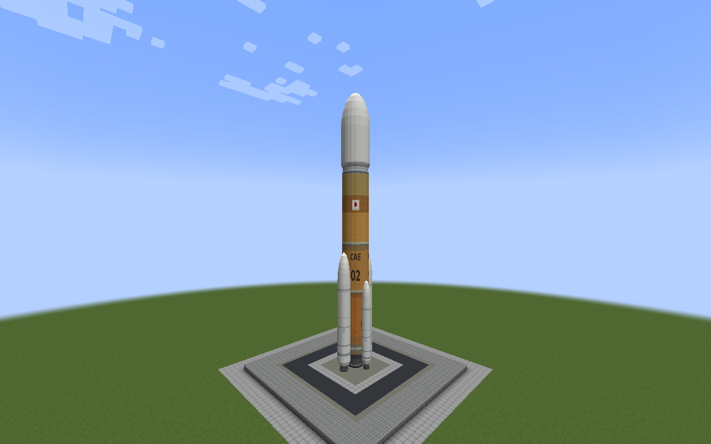
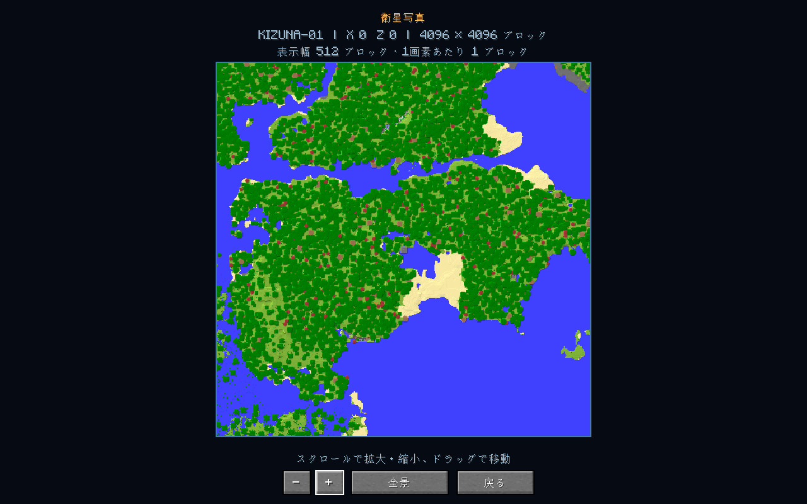

# Create: Aerospace Engineering

**English** | [日本語](README.ja.md)

A [Create](https://modrinth.com/mod/create) add-on: launch rockets from a pad, put satellites into orbit, find and command them from
a ground control console, and watch them cross the night sky. Everything happens in the normal world; there is no trip to space.

Minecraft **1.21.1**, NeoForge, Java **21**. The required and optional mods are listed in the
[installation guide](dist/README.md) (Japanese).

| To | Go to |
| --- | --- |
| Learn how it works: numbers, recipes, controls | [Specifications](docs/README.md) (Japanese) |
| Install it: latest JAR, optional integrations | [Installation guide](dist/README.md) (Japanese) |
| Add satellites or rockets from another mod | [API for other mods](docs/api.md) (Japanese) |
| See what changed | [Changelog](CHANGELOG.md) (Japanese) |





## Features

- **Launch pad and rockets**. Fill the pad with up to 8000 mB of fuel (lava, `#c:fuel`, `#c:diesel`, and naphtha, methanol,
  low-sulfur diesel and hydrogen from Refinery 'n' Reactors), stand a rocket on it, load satellites and fire it with redstone.
  Payloads have a mass and rockets a maximum payload: the standard rocket (60 m, 1000 kg) carries two 500 kg satellites. When several players load one rocket, each owns the
  satellite they loaded.
  [Launching](docs/launch.md)
- **H3 rockets**. The JAXA / Mitsubishi Heavy Industries H3 at full size (1 block = 1 m) in its three flown configurations, 30S,
  22S and 24W, with the steam cloud, the SRB-3 flame and trail, the hydrogen flame of the LE-9 and the SRB-3 and fairing
  separations. [H3](docs/launch.md#h3ロケットh3_30sh3_22sh3_24w)
- **Falcon 9**. The SpaceX Falcon 9 at full size (70 m). After it releases its satellites the first stage flips, burns back,
  falls with its grid fins out, lands on its legs on the pad it left and can fly again once a Service Gantry has serviced it and
  the pad is refuelled. 30% of boosters do not come back and 10% crash on landing. [Falcon 9](docs/launch.md#ファルコン9falcon_9)
- **Satellites and orbits**. A satellite goes into geostationary orbit over the equator at the launch longitude. Change its
  altitude (four tiers) and inclination (0, 30, 55, 90 degrees) to have it cross the sky; a change keeps it over the same spot. The
  world is a map of the Earth, one degree to 1000 blocks. [Orbits and coordinates](docs/orbit.md)
- **Ground Control Console**. Buttons on its top choose a satellite and set its mode, altitude and inclination. The screen shows
  its latitude, longitude and the block under it; the map shows the Earth as a sphere of cubes with the satellites over it in 3D.
  Only the owner and operators may change a satellite. A Display Link can show it too.
  [Console](docs/ground-console.md) · [Map](docs/map.md)
- **Reentry, abandoning and launch failures**. The reentry button under its cover brings a satellite down in a minute to burn up
  as a fireball over the console, by day as well. An abandoned satellite is debris, and a low one decays after a few days. Now
  and then (3%) a launch fails. [Reentry](docs/orbit.md#放棄と再突入) · [Launch failures](docs/launch.md#打ち上げの失敗)
- **Satellite relay and photos**. Launch a communications satellite and point a Large Satellite Dish at each base to it: the
  satellite's 27-slot shared inventory carries items between distant bases (an AE2 ME storage bus or a hopper moves them in and
  out). From the console map the satellite's owner can photograph 4,096 × 4,096 blocks of real terrain around the console (the game rule
  `caeSatellitePhotos` turns photos off). The dish moved here from
  Frontier Science and keeps its old registry ID. [Relay and photos](docs/satellite-relay.md)
- **The night sky**. Every satellite above your horizon is a moving dot, seen from where you stand; a geostationary one stays in
  one place. [The sky](docs/orbit.md#夜空)
- **Control Computer**. With [Create: Frontier Science](https://github.com/Chemi-Create-Team/Create-Frontier-Science) 0.3.32 or
  newer, the console's controls and map are also the **Satellites** app of its display boards. Optional.
  [Control Computer](docs/control-computer.md)
- **API for other mods**. Other mods register their own items as satellite payloads or as rockets, and read the satellites'
  positions and data to build a GPS or a relay. Both sides stay optional. [API](docs/api.md)

## Building

```bash
./gradlew build
./gradlew runGameTestServer
```

The JAR is written to `build/libs/`; released JARs and their hashes are in `dist/`. Developers start from [AGENTS.md](AGENTS.md).

## Credits

The land of the cube Earth is taken from [Natural Earth](https://www.naturalearthdata.com/) 1:50m land and lakes, public domain.
