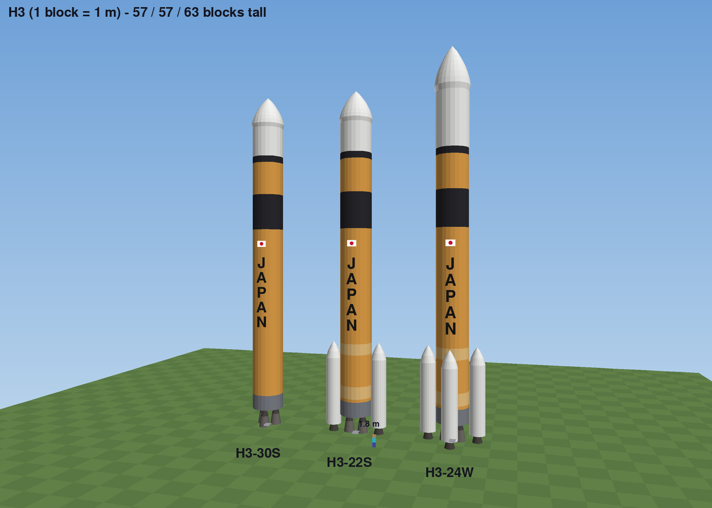
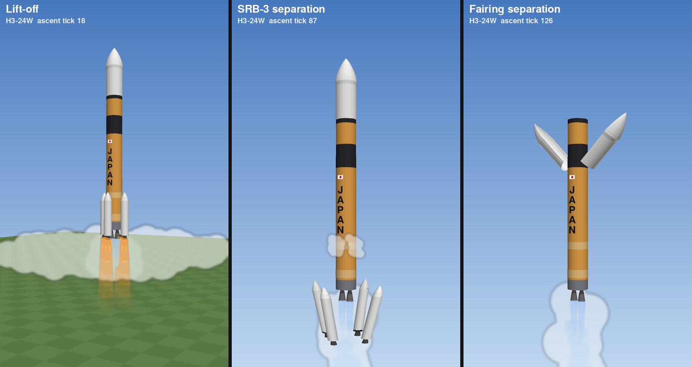

# 打ち上げ

流れ：発射台に燃料を入れる → **ロケット**を発射台に使って立てる → **ペイロード**（人工衛星など）を最大積載量まで積む → レッドストーン信号で発射。積んだペイロードは1個ずつ別の衛星になります。

## 発射台（`launch_pad`）

| 項目 | 値 |
| --- | --- |
| 大きさ | 1ブロック、高さ4/16 |
| 燃料タンク | 8000 mB（`RocketApi.MAX_FUEL_MB`）。バケツ・パイプで入れる（側面すべて） |
| 打ち上げ1回の消費 | ロケットの種類ごと（CAEのロケットは4000 mB） |
| 燃料 | 流体タグ `create_aerospace_engineering:rocket_fuel`：溶岩、`#c:fuel`、`#c:diesel`。RnRがあればナフサ・メタノール・低硫黄ディーゼル・水素 |
| 発射の条件 | ペイロードを1個以上積んだロケットが立っていて、そのロケットの消費量以上の燃料があり、**新しく**レッドストーン信号が入ったとき。足りなければディスペンサーの失敗音を鳴らし、何も変えない |
| 読み取り | 空の手で右クリック：燃料の量・容量・この発射の消費量、ロケットの種類・積んだ数・積載重量/最大積載量 |
| 降ろす | スニーク＋空の手で右クリック：立っているロケットとペイロードをすべてインベントリへ戻す（入らない分は足元に落ちる） |
| 道具 | ツルハシ（石以上）。レンチで回収できる |

製法（作業台）：上段に鉄板3、中段に鉄板・液体タンク・鉄板、下段に安山岩ケーシング3。

## ロケット（アイテム `rocket`）

| 項目 | 値 |
| --- | --- |
| 最大積載量 | 1000 kg |
| 燃料 | 4000 mB |
| 上昇 | 加速度 0.03 ブロック/tick²、最高 2.5 ブロック/tick、200ブロック |
| 大きさ | 幅10 × 高さ60 ブロック（10 × 60 m） |
| 重ねられる数 | 4 |

- 発射台に使うと、その上にロケットが1機立ち、アイテムを1個消費します（クリエイティブでは減りません）。
- 発射台にすでにロケットがあるか、幅10×高さ60ブロックの範囲に障害物や他のロケットがあると立ちません。先端まで建築上限内に収めてください。
- ツールチップに最大積載量・燃料・幅と高さが出ます。白い先端と4本の白い補助ブースター、金褐色の胴体が標準ロケットの外観です。

製法（作業台）：上段に銅板、中段に鉄板・液体タンク・鉄板、下段に鉄板・プロペラ・鉄板。

他のMODが登録したロケット（[ロケットAPI](api.md#ロケットapi)）も、同じように発射台に使えます。数値・大きさ・見た目はそのMODが決めます。

## H3ロケット（`h3_30s`・`h3_22s`・`h3_24w`）

JAXAと三菱重工業のH3ロケットを、**実寸大**（1ブロック＝1 m）で再現したものです。実際に飛んだ3つの形態があります。

画像はゲームを起動せずに、`client/H3Renderer` と同じ寸法・色から描いた確認用の図です。煙と蒸気の雲は実際のパーティクルの近似です。

| 形態 | 1段LE-9 | SRB-3 | フェアリング | 最大積載量 | 燃料 | 高さ × 幅 |
| --- | --- | --- | --- | --- | --- | --- |
| H3-30S | 3基 | なし | ショート | 4000 kg | 3760 mB | 57 × 5.2 |
| H3-22S | 2基 | 2本 | ショート | 4800 kg | 5830 mB | 57 × 10.4 |
| H3-24W | 2基 | 4本 | ワイド | 6500 kg | 8000 mB | 63 × 10.4 |

- 寸法（実機）：全長57 m（ショート）／63 m（ワイド）、直径5.2 m（ワイドのフェアリングは5.4 m）、1段37 m、2段12 m、フェアリング10.4 m／16.4 m、SRB-3は直径2.5 m・全長15 m。
- 最大積載量：CAEの衛星は静止軌道に入るので、静止移行軌道の能力を使います。22Sは5号機の実績4.8 t、24Wは計画値6.5 t（ロングコースト）。30Sは静止移行軌道の公表値がないため、太陽同期軌道500 kmへの4 tです。人工衛星（500 kg）なら8・9・13機です。
- 燃料は打ち上げ時の質量（270 t・419 t・575 t）に比例させ、575 tの24Wで発射台いっぱいの8000 mBです。加速は推力重量比の順で、30Sがいちばんゆっくり、24Wがいちばん速く上がります。上昇は256ブロック、最高2.5ブロック/tickです。
- 外観：1段と2段は黄橙色の断熱材（ポリイソシアヌレートフォーム）、段間部と衛星分離部は黒い炭素繊維、フェアリングとSRB-3は白、エンジン部は灰色。SRB-3の取付部は仕上げが違うため色が少し明るい帯になります。1段に「JAPAN」の文字と日の丸。
- 発射の演出：
  - 発射直後：発射台の散水が蒸気になった雲が地面を広がり、轟音が続きます。
  - SRB-3：明るい炎と、空中に残る太い白煙の柱。
  - LE-9：液体水素の炎はほとんど透明なので、淡い青の炎とショックダイヤモンド（明るい節）、薄い水蒸気の尾だけです。30Sは白煙のない静かな上昇になります。
  - 上昇の35%でSRB-3が分離し、外へ傾きながら落ちていきます。70%でフェアリングが2つに割れて開き、落ちていきます。そのあと衛星を放出します。
- 発射台は1ブロックのままですが、機体の幅と高さの空間（24Wなら発射台を中心に約11×11、高さ63ブロック。先端まで建築上限内）が空いている必要があります。

製法（作業台）：
- H3-30S：上段に鉄板・精密機構・鉄板、中段に液体タンク・ロケット・液体タンク、下段に鉄板・ブレイズバーナー・鉄板。
- H3-22S：H3-30Sの両側に火薬、下の両隅に鉄板（SRB-3を2本足す）。
- H3-24W：H3-22Sの上に真鍮板、両側に火薬、下の両隅に鉄板（SRB-3を4本に、フェアリングをワイドに）。

## 人工衛星（`satellite`）

- 重さ **500 kg**。CAEのロケットには2個まで積めます。
- 立っているロケットに使うと、アイテムを1個消費して積みます。積むと最大積載量を超えるときは「重すぎる」と出て積みません。ロケットが立っていなければ「先にロケットを立てる」と出ます。
- 金床で付けた名前が衛星の名前になります（最大50文字）。名前がなければ `SAT-xxxx`（16進4桁）です。
- 最大16個まで重ねられます。ツールチップに重さが出ます。

製法（作業台）：上段に真鍮板・電子管・真鍮板、中段に鉄板・精密機構・鉄板、下段に真鍮板・電子管・真鍮板。

他のMODが登録したペイロード（[ペイロードAPI](api.md)）も同じように積めます。重さはそのMODが決めます（指定がなければ500 kg）。

## ロケット（エンティティ `rocket`）

| 項目 | 値 |
| --- | --- |
| 大きさ | ロケットの種類の幅 × 高さ |
| 待機中 | 発射台の上に立つ。下が発射台でなくなると（0.5秒ごとに確認）、ロケットのアイテムと積んだペイロードを落として消える |
| 上昇 | 種類ごとの加速度・最高速度。発射位置から種類ごとの高さだけ上がるか、先端が建築上限に届くと（機体が高さ4ブロック未満でも底面は4ブロック手前で止まる）、積んだ順に衛星を放出して消える |
| 保存 | 種類のID、立てたときのアイテム、積んだペイロード（データごと）、上昇の進み |

放出された衛星は、発射した経度の赤道上の静止軌道に入ります（[軌道と座標](orbit.md)）。持ち主は、最後にペイロードを積んだプレイヤーです。持ち主がオンラインなら衛星ごとに「〜 が軌道に乗った」と通知します。

種類を登録したMODを外したワールドでは、そのロケットはCAEのロケットの数値で飛び、CAEのモデルで描かれます（種類のIDは保存に残り、MODを戻すと元に戻ります）。0.1.6以前に立てたロケットは、CAEのロケットとして扱い、積んでいた1個をそのまま運びます（ロケットのアイテムは持っていないので、降ろしても戻りません）。
