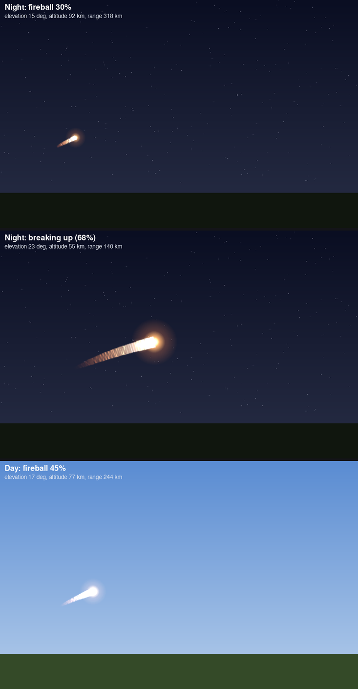

# 軌道と座標

## 世界と緯度経度

| 項目 | 値 |
| --- | --- |
| 1度 | 1000ブロック |
| 経度 | x。東がプラス |
| 緯度 | -z。北がマイナスz |
| 地球の自転 | Minecraftの1日（24000 tick）で1回転 |
| 地球の半径（見え方の計算） | 6371 km |

北緯12.0度・東経45.0度の衛星は、x = 45000、z = -12000 の上空にあります。衛星の位置は保存せず、軌道とゲーム時刻から毎回計算します。

## 軌道の段階

| 段階 | 高度 | 周期 |
| --- | --- | --- |
| 0 低軌道 | 500 km | 2400 tick（2分） |
| 1 | 2000 km | 3600 tick（3分） |
| 2 中軌道 | 20200 km | 12000 tick（10分） |
| 3 静止軌道 | 35786 km | 24000 tick（1日） |

軌道傾斜角は 0・30・55・90 度の4段階です。打ち上げた衛星は段階3・傾斜角0度（静止軌道）で、1か所の上空に止まります。高度や傾斜角を変えても、衛星は今いる軌道上の位置から新しい軌道に移ります。

## 衛星のモード

| モード | 夜空 | ランプの色 |
| --- | --- | --- |
| 待機 | 暗い点 | 琥珀 |
| ビーコン（打ち上げ直後） | 明るい点 | 緑 |
| 点滅 | 明滅する点 | 水色 |

## 放棄と再突入

| 状態 | 内容 |
| --- | --- |
| 運用中 | 持ち主とOPが操作できる |
| 放棄 | 地上管制コンソール・共通制御コンピュータで放棄した衛星。持ち主でも操作できなくなり（OPだけ）、ランプは消える（待機）。段階0は1〜3日後、段階1は7〜14日後に軌道が尽きて自然に再突入する。段階2・3は落ちずに残る |
| 再突入 | 軌道を離れて落ちていく。降下60秒（1200 tick）のあと、火球15秒（300 tick）で燃え尽き、一覧から消える。その間は選択以外の操作をできない |

- 再突入した衛星は、目標地点に向かう大円に沿って降り、高度120 kmから25 kmまで燃えながら進みます。火球になるのは目標の4度手前から0.5度先までで、目標から0.7度（約700ブロック）横を通るため、目標から見ると空を横切る流れ星のように見えます。
- 目標地点は、コンソールやコンピュータから再突入させたときはその場所（操作した人が火球を見られる）、放棄した衛星の自然落下ではワールドのスポーン地点から1500ブロック以内のどこかです。
- 火球は昼も夜も、地平線の上にあればどこからでも見えます。白熱した頭と黄色・橙の光、赤へ冷えていく長い尾があり、終わり近くで分裂して破片がそれぞれ尾を引きます。距離が近いほど大きく見えます。雨の日は暗くなります。
- 再突入が始まると、管制画面に警告が出ます（下記）。
- 時間はゲーム用の縮尺です（実際の火球は1〜2分、降下はもっと長い）。

## 警告

打ち上げの失敗（[打ち上げ](launch.md#打ち上げの失敗)）と再突入の開始は、地上管制コンソールの画面・衛星マップ・共通制御コンピュータのアプリに、5分間（6000 tick）点滅する警告として出ます。直近8件をワールドに保存し、表示するのはまだ5分たっていない最新の1件です。

| 警告 | 表示 |
| --- | --- |
| 打ち上げ失敗（赤） | ロケットの種類・持ち主・失った積荷の数・爆発した場所（X・Z） |
| 再突入（橙） | 衛星の名前・火球になる場所（X・Z） |

## 夜空

地平線の上にいる衛星は、夜にプレイヤーの立つ場所から見た方向へ点として描かれます（火球になっている衛星は上記のとおり昼も描きます）。動く衛星には直近の軌跡（20点、3 tickおき）の尾が付きます。静止衛星は空の1か所にとどまり、低軌道の衛星は約10秒で空を横切ります。シェーダーパックが空を置き換える場合は表示されないことがあります。

## 保存と同期

- 衛星はオーバーワールドのワールドデータ `create_aerospace_engineering_satellites` に保存します。
- 一覧と警告は、ログイン時と変わったときに全プレイヤーへ送ります。名前と持ち主名は50文字で切ります。
- 放棄したかどうか、再突入の開始tickと目標のブロック座標も衛星ごとに保存します。燃え尽きたかどうかはサーバーが1秒ごとに確かめます。
- 他のMODの衛星データ（[ペイロードAPI](api.md)）はサーバーだけに保存し、クライアントへは送りません。

## コマンド（権限レベル2）

| コマンド | 内容 |
| --- | --- |
| `/satellite list` | 全衛星の名前・位置・高度・周期 |
| `/satellite add <名前> [段階 0-3]` | 実行した場所の経度に衛星を追加。段階を省くと静止軌道、それ以外は傾斜角55度 |
| `/satellite remove <名前>` | その名前の衛星をすべて取り除く（すぐに消え、火球にならない） |
| `/satellite reenter <名前>` | その名前の衛星を、コマンドを実行した場所に向けて再突入させる |
| `/satellite abandon <名前>` | その名前の衛星を放棄する |
