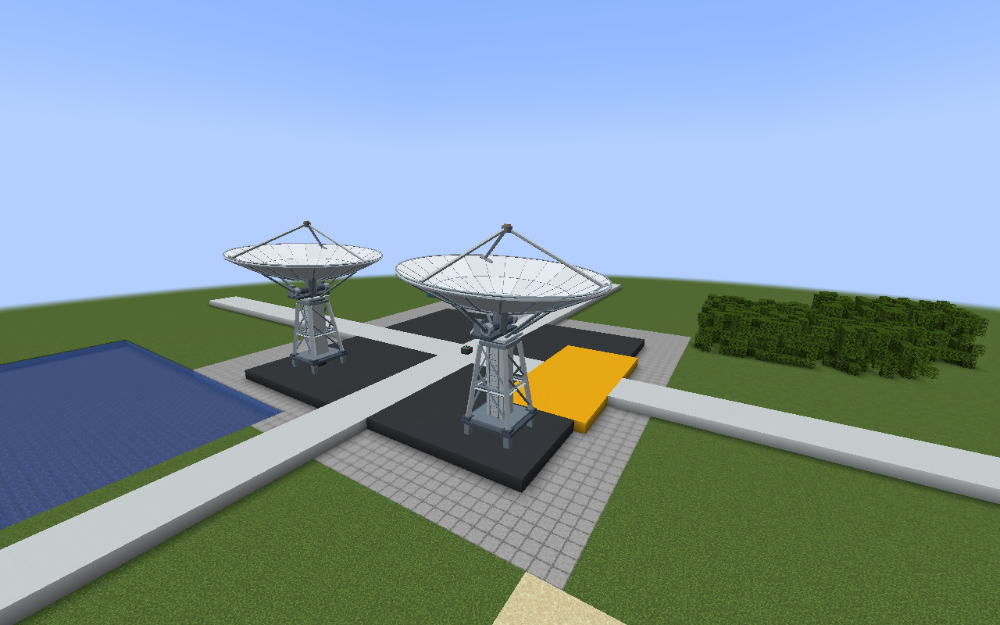
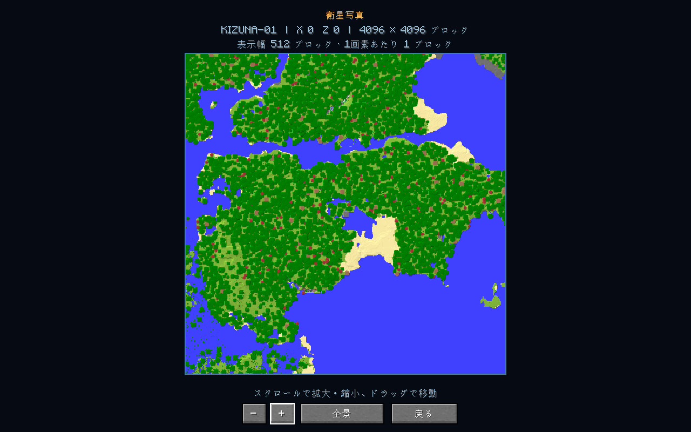

# 衛星中継と衛星写真

## 配置とアイテム中継

1. 金色の反射鏡を2枚持つ**通信衛星**（`create_aerospace_engineering:communication_satellite`、500 kg）を作ります。発射台にロケットを立て、通信衛星を積んで発射します。打ち上げの操作と軌道は[打ち上げ](launch.md)を参照してください。
2. オーバーワールドの各拠点に**大型衛星パラボラアンテナ**を1基置きます。反射面の直径は15ブロック、軸は台座から8.75ブロック上です。台座の周囲半径9、上方18ブロックを空けると機体を見やすく配置できます。設置・接続・採掘の対象は台座です。
3. 台座を空の手でスニーク右クリックすると、操作できる通信衛星や復旧用の在庫を順番に選びます。両側で同じ衛星を選択します。通常の右クリックで衛星名と状態を確認できます。
4. 各拠点の台座にAE2の**MEストレージバス**を向け、各バスをそれぞれのMEネットワークにつなぎます。送信側のMEターミナルで共有在庫へ預け、受信側のMEターミナルから取り出せます。輸出バスと輸入バスを台座につないで自動化することもできます。

- 衛星ごとに共有在庫が27スロットあります。送信先のチャンクを強制ロードせず、受信側が後から読み込まれても在庫を取り出せます。MEネットワークは拠点ごとに独立し、電力とAE2チャンネルは各拠点で供給します。同じMEネットワークへつなぐストレージバスは衛星ごとに1つにしてください。
- 台座は、通信に使える衛星を自動追尾します。衛星が地平線上にあり、ビーコンまたは点滅モードの間だけ入出力できます。対象範囲はオーバーワールドのCAE座標マップ（X ±180,000、Z ±89,000の内側）です。AE2は任意で、台座は標準のアイテム搬送にも対応します。
- 台座の設定は設置者かOP、衛星の選択は衛星の所有者かOPが行えます。入出力は台座につないだ装置が行います。軌道離脱や放棄の後は残りの品物を回収できます。アンテナを置き直した場合も、衛星の所有者は在庫が残った復旧枠を選べます。選んだ衛星と共有在庫はサーバーに保存されます。

## 製法（作業台）

| 作るもの | 上段 | 中段 | 下段 |
| --- | --- | --- | --- |
| 通信衛星（4個まで重ねられる） | 金板・電子管・金板 | 青色の色付きガラス・人工衛星・青色の色付きガラス | 金板・電子管・金板 |
| 大型衛星パラボラアンテナ | 亜鉛インゴット・鉄板・精密機構 | 真鍮板・精密機構・真鍮板 | 中央に真鍮ケーシング |

どちらもCreateの材料だけで作れ、AE2やFrontier Scienceは要りません。

## 移設

台座のブロック、アイテム、ブロックエンティティはいずれも旧ID `create_frontier_science:me_parabolic_antenna` のままです。所有者と向きを保持します。以前のメモリーカードで設定した局は、同じ衛星を選び直してMEストレージバスを接続します。CFSで打ち上げたME中継衛星も使えます。両MODを同時に使う場合は、CAE 0.1.12とCFS 0.3.32以降を組み合わせてください。

## 衛星写真

1. 地上管制コンソールで、地平線より上に見え、ビーコンか点滅モードの通信衛星を選択します（待機中・放棄・再突入中の衛星では撮影できません）。
2. 「マップ」を開き、画面下の「衛星写真」を押すと、コンソールを中心とする地表画像が表示されます。
3. 北を上にした**4,096×4,096ブロック**を撮影します。最大縮尺のマップ4枚を2×2に並べた範囲です。全景は1,024×1,024画素（4ブロック／画素）で、拡大すると2ブロック／画素、さらに1ブロック／画素まで表示します。ホイールか「＋」「−」で縮尺を変え、ドラッグで移動します。
4. サーバーは読み込み中のチャンクとディスクに保存済みのチャンクから、地表色と起伏の陰影を取得します。未生成の領域は濃紺です。画像は256×256画素の区画ごとに順次届きます。撮影で新しいチャンクを生成したり、強制ロードしたりすることはありません。撮影開始はサーバー全体で1秒に1回までです。

写真は地上管制のマップから開く専用画面です。Frontier Scienceの共通制御コンピュータでは、通信衛星の立体マップと既存の軌道操作を表示します。

## 検証

NeoForge 21.1.228の専用サーバーで、通信衛星の打ち上げ、共有在庫の保存と軌道離脱後の回収、地表画像を含むGameTest 30件が通過しました（0.1.14では傾斜角の変更の検査を足して31件）。開発中のAE2 19.2.19の実機テストでは、24,000ブロック隔てた2系統のMEストレージバスで銅インゴット32個の移動を確認しました。RTX 4060環境のMinecraftでアンテナの追尾と、地上管制からの衛星写真の表示を確認しました。
